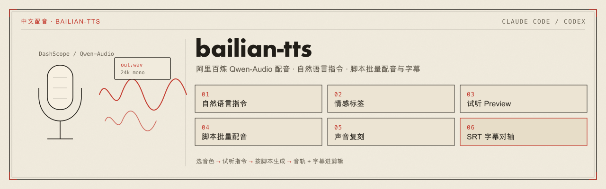

<p align="center">
  
</p>

# bailian-tts

> 一个跨 **Claude Code**、**Codex** 与 **Pi** 的插件（基于开放标准 [skill](https://agentskills.io)）：用阿里百炼 `qwen-audio-3.1-tts-flash` 把文案合成自然语音。
>
> ← 返回[仓库总览](../../README.md) ｜ 姊妹插件：[privatize-fork](../privatize-fork/)

同一份技能可安装到 Claude Code、Codex 与 Pi。配音与声音复刻使用百炼 `qwen-audio-3.1-tts-flash`，工作台试听及选中朗读另可切换 Next 或 Eleven v4。Flash 的68 个系统音色都接受任意自然语言指令，文案里可以直接嵌入情感与拟声标签，还能用自己的录音复刻音色。

## 解决什么问题

做视频、PPT、课件、演示或产品旁白时，常见问题不是“能不能合成语音”，而是每次都要重新写 SDK 调用、查音色、记模型和音色的绑定关系、处理 `411` 报错，再拿音频时长去对时间轴、手打字幕。

`bailian-tts` 把这些固定动作收进一个技能：

| 能力 | 说明 |
|------|------|
| **音色清单** | 内置 68 个系统音色数据（多语种与方言 / 精品中文 / 精品英文 / 其他），可按性别、场景筛选。 |
| **自然语言指令** | `--instruct "沉稳的中年女声，语速偏慢"` 原样传给模型，不需要固定句式；也可用 `--emotion` 快捷指定情感。 |
| **文本内标签** | 在文案里写 `[excited]`、`[serious]` 切换情绪，写 `[laughing]`、`[sighing]` 插入拟声。 |
| **方言与多语种** | 4 个音色支持上海话、广东话、东北话、重庆话等 8 种方言和 8 种外语，用指令切换。 |
| **先试听再生成** | `preview` 合成一句并播放；`gen` 生成正式 `wav`，统一规范化为 24kHz 单声道并打印时长。 |
| **脚本批量配音** | `script` 按脚本逐段生成，每段可切换音色和指令，输出分段 `wav`、拼接好的 `all.wav`、`subtitles.srt` 和 `manifest.json`，可直接拖进剪辑工具。 |
| **配音工作台** | `ui` 在浏览器打开一个本地页面，顶栏四栏：**开始**介绍插件能做什么、检查运行环境，并引导创建 API Key（助手在默认浏览器打开百炼控制台的创建页、交给你操作，你复制后它读剪贴板、校验并保存，key 不出现在对话里）；**选音色**左侧清单列出 68 个系统音色和本模型可用的复刻音色，右侧试听台用同一句话逐个现场合成，清单上记下每个音色这条的时长，满意的收藏、设为默认，复刻音色也能在这里删除；**选中朗读**（仅 macOS）一键安装朗读入口，选好鼠标和按键后确认即可自动改 OpenLogi 配置（先整份备份、只改这一个键），键盘快捷键一键配置（本机编译并启动后台小助手「百炼朗读助手」，向系统注册 ⌃⌥⌘S 等全局快捷键，Orca、终端里也有效；首次需开辅助功能权限，可一键移除），并能现场试读、查看朗读日志；**声音复刻**是「录音 → 质检 → 试听 → 完成」四步向导，开录后整屏只留念稿、大号计时和电平表，录完先给结论再逐项列出时长、音量、破音和波形。第一次使用时总是先落在「开始」。服务只监听 `127.0.0.1` 并校验一次性 token，页面不引用任何外部资源。 |
| **Eleven v4 / Turbo** | 工作台支持 `eleven_v4` 与 `eleven_v4_turbo`，共用 Key 和收藏；Turbo 使用官方 TTD WebSocket 接收音频，仍收齐整段后播放，不恢复文本分段。独立保存 ElevenLabs API Key、读取账号音色和管理本地收藏；第 1 个收藏供中键朗读使用。首次从账号音色导入可用的 Siqi Liu、Adrian、Roger，百炼收藏不变。密钥由用户在密码输入框保存，权限 600，不经过对话；也支持 `ELEVENLABS_API_KEY`。先校验 Key 并保存模型设置，再由用户点击试听（消耗 ElevenLabs 额度）。 |
| **朗读字数** | 顶部选择模型后可配置独立的朗读字数上限，初始均为 1500 字；保存后用于中键、快捷键与试读。Flash 可设 1～20000，Next 1～2800，Eleven v4 / Turbo 各 1～2000。CLI 的 `say --max N` 可覆盖本地值；输出时长限制不变，UI 音色试听仍最多 200 字。 |
| **模型切换** | 工作台顶部展开「默认模型」，可保存 Flash / Next / Eleven v4 / Eleven v4 Turbo 切换，同时用于 UI 试听及 `gen` / `script` / `preview` / `say`。Next 沿用 API Key，需配置北京业务空间 ID 与文字声音描述；不使用 Flash 收藏音色。配置保存在 `~/.config/bailian-tts/settings.json`，`SFM_WORKSPACE_ID` 环境变量优先。普通场景音频最长 120 秒，长文可能无法完整朗读，建议先试短句。声音复刻与百炼音色管理仍使用 Flash。 |
| **选中即朗读** | `say`（仅 macOS）：在任意 App 里选中文字，按一下鼠标按键或快捷键就用收藏的默认音色读出来。自动去掉代码块和 Markdown 符号，按当前模型的字数配置截断（初始 1500 字）；整段一次合成，完成后播放；再按一次立即停止。`say --install` 生成 `~/.local/bin/bailian-say` 入口，并打印 OpenLogi 鼠标按键和键盘快捷键的配置方法。 |
| **声音复刻** | `clone` 直接接收本地录音（m4a/mp3/wav 等），自动转码、检查时长、上传百炼临时存储并完成复刻，无需自备 OSS；`voices --mine` 查询、`delete` 删除。 |
| **收藏音色** | `fav add` 收藏常用音色，`voices` 中标 ★；未指定音色时默认用收藏的第 1 个，收藏存在本机 `~/.config/bailian-tts/favorites.txt`，重装插件不丢。 |
| **提前拦截错配** | 音色不属于本模型（其它模型的系统音色、为其它模型创建的复刻音色）时直接提示，不让服务端只回一个 `411`。 |

## 安装

插件名 `bailian-tts@legdonkey`。完整安装方式（含桌面端图形界面、一键脚本 `install-plugins.sh`）见[根 README 的安装区](../../README.md#安装)。命令行速记：

```bash
# Claude Code
/plugin marketplace add legdonkey/legdonkey-plugins
/plugin install bailian-tts@legdonkey

# Codex
codex plugin marketplace add legdonkey/legdonkey-plugins --ref main
codex plugin add bailian-tts@legdonkey

# Pi（整个仓库作为 Pi 包安装，暴露 bailian-tts 与 privatize-fork）
pi install git:github.com/legdonkey/legdonkey-plugins
```

装完重启对应客户端（Pi 会话内可用 `/reload`）。触发名：**Claude Code** 用 `/bailian-tts`（插件命名空间下 `/bailian-tts:bailian-tts`）；**Codex** 用 `$bailian-tts`；**Pi** 用 `/skill:bailian-tts`。也可以不点名，直接说「帮我配一段音」，模型会自动调用。Pi 下用 `pi update` 跟进新版本。

## 运行环境

插件通过标准库启动器准备专用 Python 环境，不依赖插件市场的安装后钩子。安装插件本身不会运行 pip；首次使用时由助手先征求同意，或在交互式终端确认，再创建/修复 `~/.bailian-tts-venv` 并从阿里云 PyPI 镜像安装固定版本依赖。环境保存在用户目录，插件升级不删除它，不要求 sudo。

```bash
# skill_dir 是安装后的技能目录，包含 SKILL.md 和 scripts/
python3 "$skill_dir/scripts/run.py" --check
python3 "$skill_dir/scripts/run.py" --setup --yes  # 明确同意后初始化
python3 "$skill_dir/scripts/run.py" ui
```

后续技能、工作台和新安装的中键入口统一使用该环境；旧的 `tts.py` 命令也会转交启动器。旧版中键入口需用 `run.py say --install` 更新一次。启动器不常驻：只有打开工作台时才运行本地 HTTP 服务，中键朗读不依赖它。非交互模式缺依赖时只给出初始化指引，不读取 stdin 正文作为确认，也不静默安装。可用 `BAILIAN_TTS_VENV` 指定其他用户目录；不要指向插件缓存内部。下载失败时修复网络后重跑初始化，正常失败会释放安装锁，异常终止残留的锁只在确认没有安装任务后手动移除。

固定依赖见 `scripts/requirements.txt`；镜像来源为阿里云 PyPI，必要时对照官方 PyPI 校验。

API key 读取顺序是环境变量 `DASHSCOPE_API_KEY`，然后是 `~/.dashscope_key`。第一次使用时技能会自动打开工作台的「开始」页带你创建：在百炼控制台（华北2 北京）创建并复制 key 后，由 `tts.py key --clipboard` 或页面按钮读取剪贴板、向百炼校验，再写入 `~/.dashscope_key`（权限 600）并清空剪贴板。不要把 key 写进项目文件或对话内容。

还需要本机有 `ffmpeg`；macOS 试听播放用系统自带的 `afplay`。

## 用法

触发后，告诉模型你要合成的文案、想要的语气和用途。典型流程是：

0. 第一次用时会先打开配音工作台的「开始」页，按页面和助手的引导创建并保存 API Key；
1. 说一句「帮我选个音色」，会打开工作台的「选音色」，在浏览器里用同一句话逐个试听，满意的收藏或设为默认（之后不指定音色就默认用收藏的第 1 个）；也可以用 `voices --gender 女 --scene 新闻播报` 之类的条件在命令行缩小范围、`fav add` 收藏；
2. 用 `preview` 试听 1 到 2 个候选，确定音色和指令；
3. 单段用 `gen`；多段旁白写成脚本交给 `script`，拿到 `all.wav` 和 `subtitles.srt`；
4. 想在任意 App 里选中文字就读出来：说一句「帮我配置选中朗读」，会打开工作台的「选中朗读」，在页面上装好入口、配好鼠标按键（OpenLogi 可确认后自动写入）或快捷键，并当场试读；
5. 想用自己的声音：说一句「复刻我的声音」，会打开工作台的「声音复刻」，在浏览器里录音、试听、收藏一次走完；已有录音文件也可以直接交给 `clone`。

脚本格式示例（每行一段，`@voice` / `@instruct` 切换之后各段的设置）：

```text
@voice xuyuyuan_v3.1
@instruct 沉稳知性的女声，语速适中
各位好，欢迎来到今天的发布会。
@voice yuxiaoyun_v3.1
@instruct 年轻活泼的女声，语速偏快
[excited]它真的太好用了！[laughing]
```

底层脚本是 `skills/bailian-tts/scripts/tts.py`，会从自身相邻的 `references/voices.json` 读取音色数据，不依赖固定安装路径。

## 模型支持边界

Flash 的音色与模型强绑定：系统音色以 `_v3.1` 结尾，复刻音色 ID 以 `qwen-audio-3.1-tts-flash-` 开头。

不在范围内：

- `qwen-audio-3.1-tts-next`（多人对话、配乐、音效一体生成）——能力与调用方式不同，需单独设计；
- 声音设计（按文字描述生成音色）——官方目前只对 `qwen-audio-3.0-tts-*` 开放；
- 百炼上的其它语音合成模型。

## 安装验证

```bash
python3 -m unittest discover -s plugins/bailian-tts/skills/bailian-tts/scripts -p 'test_*.py'
# 以下验收会真实下载依赖，但不读取真实用户配置、不调用模型：
python3 plugins/bailian-tts/skills/bailian-tts/scripts/smoke_install.py --claude
python3 plugins/bailian-tts/skills/bailian-tts/scripts/smoke_install.py --codex
```

两种验收分别使用真实市场安装命令和临时 HOME / 宿主配置目录：安装插件副本、确认前不安装、初始化、直接启动 tts.py、重复启动复用环境、工作台启动与退出，以及 macOS 中键入口和缓存升级回退。临时用户没有 Key 或收藏。其他平台不执行 macOS 中键安装步骤；该验收不证明真实 API 权限、额度或音频合成可用。

## 插件结构

```text
plugins/bailian-tts/
├── .claude-plugin/plugin.json      # CC 插件清单
├── .codex-plugin/plugin.json       # Codex 插件清单（skills 指向 ./skills/）
├── assets/                         # README 配图（src/ 为可编辑源，由根 assets/build-svg.sh 生成）
└── skills/bailian-tts/
    ├── SKILL.md                    # 入口（可自动调用）
    ├── agents/openai.yaml          # Codex 专属元数据
    ├── scripts/run.py              # 标准库启动器与环境初始化，不常驻
    ├── scripts/requirements.txt    # 固定 Python 依赖版本
    ├── scripts/tts.py              # 合成、试听、脚本批量配音、选中朗读、声音复刻、本机页面服务
    ├── scripts/smoke_install.py    # 隔离用户目录的真实市场安装验收
    ├── assets/studio.html          # 配音工作台页面：开始 / 选音色 / 声音复刻 / 选中朗读（由 ui 在本机提供）
    └── references/
        ├── voices.md               # 指令、文本标签、复刻与排错说明
        └── voices.json             # qwen-audio-3.1-tts-flash 音色清单
```
